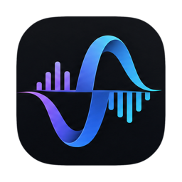
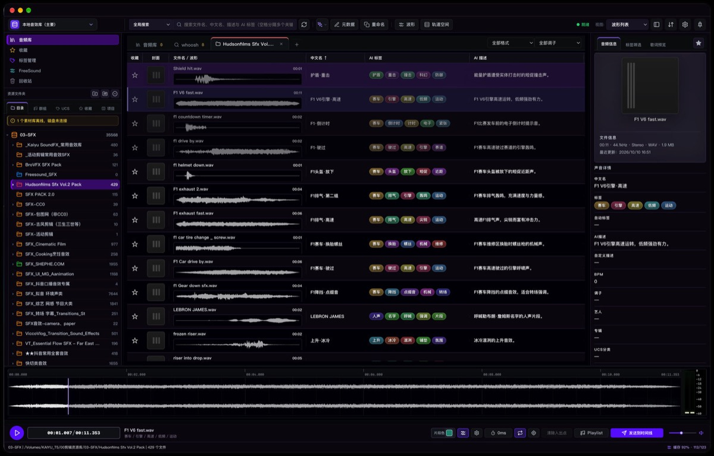
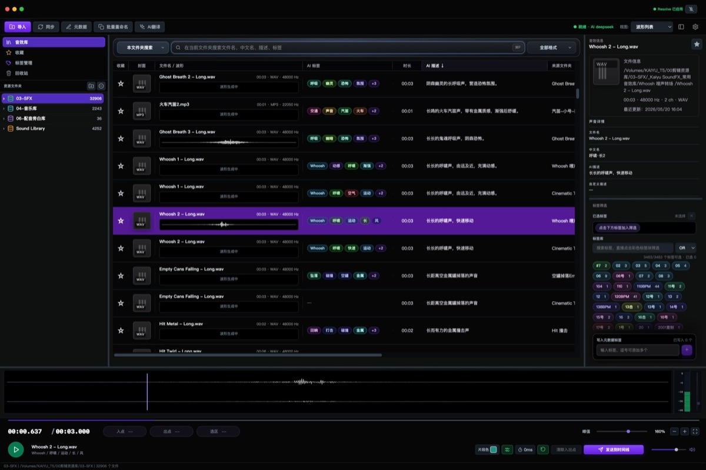
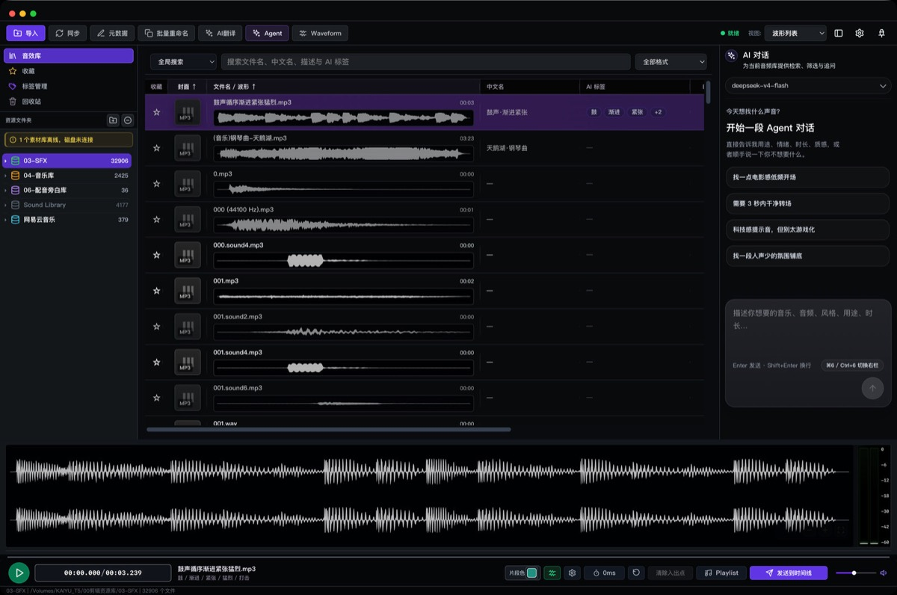
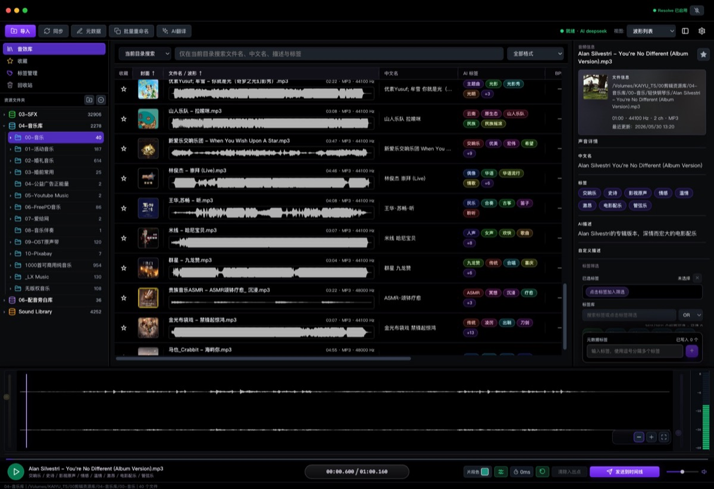

<h1 align="center">SonicLab Flow</h1>

<strong>本地音效库 · 专业工作台</strong>

检索、试听、整理、交付 —— 万级音效素材，在一台机器上完成。

  
  

  
  
  
  

<a href="https://garrygit888.github.io/SonicLab_Flow_Updates/">产品官网</a> · <a href="https://cnb.cool/garrykai/SonicLab_Flow_Updates/-/releases/tag/v0.6.9">CNB 下载</a> · <a href="https://github.com/GarryGit888/SonicLab_Flow_Updates/releases/tag/v0.6.9">GitHub 下载</a> · <a href="#联系开发者">联系开发者</a>

> **当前为闭源 BETA 测试版。** SonicLab Flow 是独立开发的商业软件，源码不公开，本仓库只提供安装包、发行信息与产品文档。

## SonicLab Flow 是什么

SonicLab Flow 面向影视剪辑师、声音设计师、游戏音频与音效库整理者。它把音效库的检索、试听、标签整理与交付放进同一个桌面窗口：直接挂载本地素材目录，不搬动原始文件，用中文名、标签、AI 描述和波形快速判断，再把选中的声音一键送到剪辑时间线。

| 核心原则 | 说明 |
| --- | --- |
| 本地优先 | 素材、索引、波形缓存与元数据都留在本机，音频文件不上传云端。 |
| 专业工作流 | 检索 → 试听 → 整理 → 交付，常用操作集中在同一窗口，减少工具往返。 |
| 元数据跟随文件 | 中文名、标签、描述与封面写回文件本身，兼容 UCS，换工具、换机器信息不丢。 |
| 为大体量设计 | 万级素材即时过滤，双层波形与并行加载保证滚动和试听不卡顿。 |

## 主要能力

- **中文直达检索**：文件名、中文名、标签与 AI 描述并行过滤，中文关键词可以直接命中英文素材库。
- **点击即播**：点击列表行内任意位置立即出声，行内波形与底部主波形同步点亮，长音频也快速响应。
- **双层波形引擎**：预览层先行显示，高清层无缝补齐；底部主波形用于确认细节与出入点。
- **UCS 元数据管理**：中文名、标签、描述、封面一次编辑并写回文件本身，支持 UCS 分类字段。
- **标签与批量整理**：标签库、颜色标记、Flag 标记、重命名、批量操作与播放列表，整理动作集中在一处。
- **AI Agent 助手**：右侧面板提供对话式检索与推荐，模型可切换，找不到声音时直接描述用途、情绪与时长。
- **AI 中文标签与描述**：自动为英文素材生成中文标签与描述，让没有整理过的库也能被中文检索。
- **直达剪辑时间线**：选中音频一键发送到 DaVinci Resolve 时间线，也支持拖拽进其他剪辑软件。
- **FreeSound 集成**：在应用内搜索、试听 FreeSound 素材，完成 OAuth2 授权后可直接下载原文件。
- **跨平台桌面端**：提供 macOS Apple Silicon、macOS Intel 与 Windows x64 版本。

## 产品预览

<table>
  <tr>
    <td width="50%"> <strong>万级检索</strong> 文件名、中文名、标签与 AI 描述并行过滤，中文关键词直达英文库。</td>
    <td width="50%"> <strong>AI Agent 助手</strong> 对话式检索与推荐，按用途、情绪与时长描述想要的声音。</td>
  </tr>
  <tr>
    <td colspan="2"> <strong>双层波形与极速试听</strong> 行内波形点击即播，底部主波形负责细节确认与出入点。</td>
  </tr>
</table>

## v0.6.9 更新摘要

**新增**

- FreeSound OAuth2 免费登录：在设置中保存 Client 信息并完成一次授权，即可长期下载 FreeSound 原文件，登录凭证自动续期。

**修复**

- 修复 FreeSound 下载失败时误报“API key 无效”的问题，现按官方规则提示需要 OAuth2 下载授权。
- 修复 FreeSound 试听波形在深色界面下显示为空黑的问题。
- 修复扫描批量写库遇到数据库繁忙时长时间独占写锁，导致收藏、标签与播放状态保存被拖慢的问题。

**优化**

- FreeSound 详情面板重设计：描述支持展开收起、标签改为胶囊样式、许可证显示短名。
- 主界面工具栏更紧凑：AI 智能改为带主题色外框的图标按钮，Waveform 更名为「波形」，新增分组分隔线。

完整版本记录见 [CNB 发行页](https://cnb.cool/garrykai/SonicLab_Flow_Updates/-/releases/tag/v0.6.9) 与 [GitHub Releases](https://github.com/GarryGit888/SonicLab_Flow_Updates/releases)。

## 系统要求

| 平台 | 最低版本 | 架构 |
| --- | --- | --- |
| macOS | 10.15 Catalina | Apple Silicon（arm64）/ Intel（x86_64） |
| Windows | Windows 10 | x64（Windows 11 亦可） |

## 下载 SonicLab Flow 0.6.9

| 平台 | 主下载（CNB） | 备用下载（GitHub） |
| --- | --- | --- |
| macOS Apple Silicon | [DMG](https://cnb.cool/garrykai/SonicLab_Flow_Updates/-/releases/download/v0.6.9/SonicLab_Flow_v0.6.9_mac_arm64_installer.dmg) | [GitHub Release](https://github.com/GarryGit888/SonicLab_Flow_Updates/releases/tag/v0.6.9) |
| macOS Intel | [DMG](https://cnb.cool/garrykai/SonicLab_Flow_Updates/-/releases/download/v0.6.9/SonicLab_Flow_v0.6.9_intel_mac_installer.dmg) | [GitHub Release](https://github.com/GarryGit888/SonicLab_Flow_Updates/releases/tag/v0.6.9) |
| Windows x64 | [安装程序](https://cnb.cool/garrykai/SonicLab_Flow_Updates/-/releases/download/v0.6.9/SonicLab_Flow_v0.6.9_windows_setup.exe) | [GitHub Release](https://github.com/GarryGit888/SonicLab_Flow_Updates/releases/tag/v0.6.9) |

> **安装提示**
>
> - macOS 当前为未签名、未公证的 BETA 测试包：首次打开请在 Finder 中右键应用 →「打开」，或在「系统设置 → 隐私与安全性」中允许打开。
> - Windows 首次运行如出现 SmartScreen 提示，请选择「更多信息 → 仍要运行」。
> - 请只从上方官方发行页下载，并核对发行页中的 SHA-256 校验值。
> - 应用内更新读取 CNB 更新清单：[update/manifest.json](https://cnb.cool/garrykai/SonicLab_Flow_Updates/-/git/raw/main/update/manifest.json)。

## 快速开始

1. 下载并安装与你的系统、处理器匹配的版本。
2. 在素材库中添加音效目录，原始文件不会被复制或移动。
3. 等待本地索引完成，用文件名、中文名、标签或 AI 描述开始检索。
4. 点击行内波形试听，底部主波形确认出入点，按需补充标签与中文名。
5. 选中素材一键发送到 DaVinci Resolve 时间线，或拖拽到其他剪辑软件。

## 技术栈

       

这些徽章说明 SonicLab Flow 采用的主要技术方向。**本仓库是公开发行仓库，不包含 SonicLab Flow 的源代码**；这里只保存安装包发行信息、公开文档、官网文件与产品展示资源。

## 闭源与测试版

- SonicLab Flow 为闭源商业软件，当前处于 BETA 测试阶段，功能和交互仍可能调整。
- 本源代码不公开，不提供开源许可证；产品与文档的所有权利保留。
- BETA 阶段欢迎反馈问题与建议，但不对生产环境的稳定性作出承诺，重要项目请保留原始素材与工程备份。

## 隐私与数据

- SonicLab Flow 以本地素材库、本地数据库与本地缓存为核心，音频文件不会被上传。
- 只有在用户主动配置 AI 服务、FreeSound 授权或使用相关在线能力时，应用才会连接对应服务。
- 启用第三方模型、API 或平台前，请阅读对应服务的隐私政策与许可条款。

## 联系开发者

使用中遇到问题、想提功能建议，或者需要安装与工作流方面的帮助，可以直接联系我。

| 渠道 | 联系方式 |
| --- | --- |
| 微信 | `Garry_kai888`（添加请备注「SonicLab Flow」） |
| GitHub | [GarryGit888](https://github.com/GarryGit888) |
| B 站 | [space.bilibili.com/11074718](https://space.bilibili.com/11074718) |
| 小红书 | [Garry 的主页](https://www.xiaohongshu.com/user/profile/600255b20000000001004b60) |
| 问题反馈 | [GitHub Issues](https://github.com/GarryGit888/SonicLab_Flow_Updates/issues) |
| CNB | [cnb.cool/garrykai](https://cnb.cool/garrykai) |

提交问题时请附上 SonicLab Flow 版本、操作系统与处理器、可复现步骤，以及必要的截图或日志片段，能更快定位问题。

---

Copyright 2024-2026 SonicLab Flow. All rights reserved.

